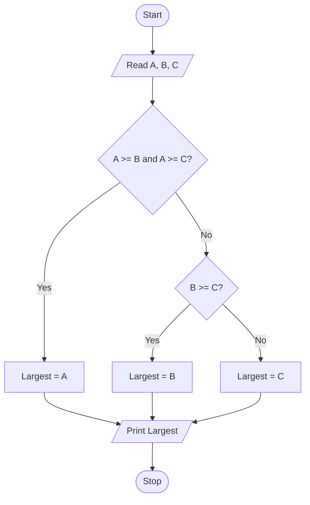

# Topic 2: Programming Design Tools (Algorithm, Flowchart, Pseudocode)

**Unit I | HCAC-104 Programming in C**

## 1. Introduction

Good programmers plan before they code. Three standard planning tools describe the solution to a problem without worrying about the exact syntax of any language: the **algorithm**, the **flowchart** and the **pseudocode**.

## 2. Algorithm

### 2.1 Definition

An **algorithm** is a finite, step-by-step sequence of instructions that solves a problem or completes a task.

### 2.2 Characteristics

1. **Input:** zero or more values are supplied.
2. **Output:** at least one result is produced.
3. **Definiteness:** every step is clear and unambiguous.
4. **Finiteness:** it ends after a limited number of steps.
5. **Effectiveness:** each step is simple enough to be carried out.

### 2.3 Example: Largest of Three Numbers

1. Start.
2. Read three numbers: A, B, C.
3. If A is greater than or equal to B and A is greater than or equal to C, then Largest = A.
4. Otherwise, if B is greater than or equal to C, then Largest = B.
5. Otherwise, Largest = C.
6. Print Largest.
7. Stop.

## 3. Flowchart

### 3.1 Definition

A **flowchart** is a diagram that shows the steps of an algorithm using standard symbols connected by arrows.

### 3.2 Common Symbols

| Symbol | Name | Use |
|---|---|---|
| Oval (rounded box) | Terminator | Start or Stop |
| Parallelogram | Input / Output | Reading data, printing results |
| Rectangle | Process | Calculations and assignments |
| Diamond | Decision | A yes/no (true/false) question |
| Arrow | Flow line | Direction of flow |
| Small circle | Connector | Joins parts of a flowchart |

### 3.3 Example Flowchart: Largest of Three Numbers

The diagram below uses Mermaid, which GitHub renders automatically.



### 3.4 Advantages and Disadvantages

| Advantages | Disadvantages |
|---|---|
| Easy to understand visually | Large programs make large, messy charts |
| Helps find logic errors early | Hard to modify once drawn |
| Useful as documentation | Redrawing takes time |

## 4. Pseudocode

### 4.1 Definition

**Pseudocode** is an informal, English-like description of an algorithm that looks like code but follows no strict syntax. It cannot be compiled.

### 4.2 Example

```text
START
  READ A, B, C
  IF A >= B AND A >= C THEN
      Largest = A
  ELSE IF B >= C THEN
      Largest = B
  ELSE
      Largest = C
  END IF
  PRINT Largest
STOP
```

## 5. Comparison of the Three Tools

| Basis | Algorithm | Flowchart | Pseudocode |
|---|---|---|---|
| Form | Numbered steps in plain language | Graphical diagram | Code-like text |
| Best for | Describing the logic first | Visualising the flow of decisions | Bridging to real code |
| Needs special symbols | No | Yes | No |
| Easy to convert to code | Moderate | Moderate | Very easy |

## 6. Applying This in C

The three tools above are turned into working C in [Program-01: Largest of Three Numbers](../../Programs/Program-01-Largest-of-Three-Numbers/README.md).

## 7. Summary

An algorithm states the steps, a flowchart draws them, and pseudocode writes them in code-like form. Using all three reduces errors before any code is typed.

## 8. Exam-Oriented Answers

### 5-mark: Define algorithm and flowchart. Draw a flowchart to find the largest of three numbers.
**Definitions.** An algorithm is a finite step-by-step procedure for solving a problem; a flowchart is its diagram built from standard symbols.
**Characteristics.** Input, output, definiteness, finiteness, effectiveness.
**Flowchart.** Use the Mermaid flowchart in section 3.3, naming each symbol (oval, parallelogram, diamond, rectangle).
**Conclusion.** Planning with these tools reduces logic errors before coding.

### 5-mark: What is pseudocode? Write pseudocode for the largest of three numbers.
Give the definition (informal, code-like, not compilable), then the pseudocode in section 4.2.

### 10-mark: Explain the programming design tools: algorithm, flowchart and pseudocode.
Define each, list algorithm characteristics, show the flowchart symbols table, give the same problem in all three forms, add the comparison table, and link it to the tested C program ([Program 01](../../Programs/Program-01-Largest-of-Three-Numbers/README.md)).

---

[Previous: Language Translators](Topic-01-Language-Translators.md) | [Next: Features of a Good Program](Topic-03-Features-of-a-Good-Program.md)
