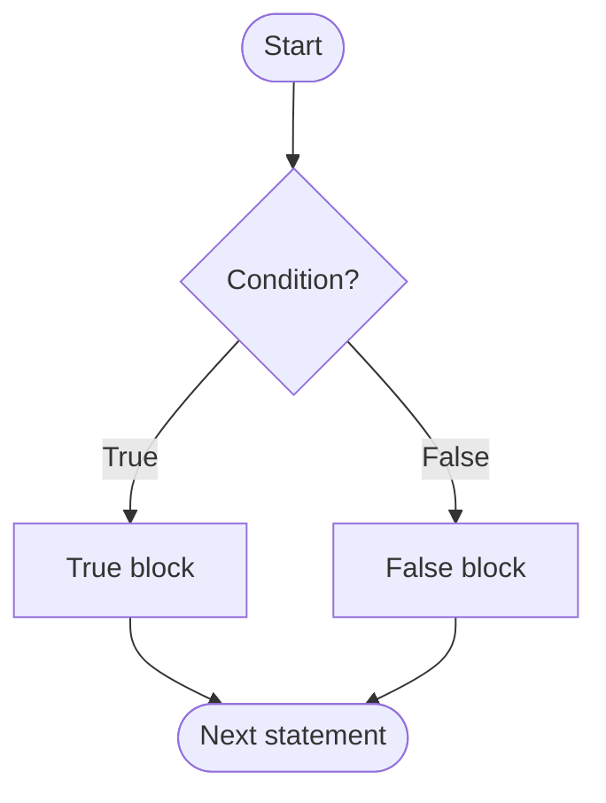

# Topic 1: Selection Statements

**Unit III | HCAC-104 Programming in C**

## 1. Introduction

**Selection (decision-making) statements** let a program choose which statements to execute depending on a condition. In C a condition is any expression: **zero is false and any non-zero value is true**. Relational expressions such as `a > b` give 1 or 0.

## 2. The `if` Statement

```c
if (condition) {
    statements;
}
```

The statements run only when the condition is true.

```c
if (marks >= 40)
    printf("Pass\n");
```

## 3. The `if-else` Statement

```c
if (condition) {
    statements_if_true;
} else {
    statements_if_false;
}
```



Tested: [Program 11: Even or Odd](../../Programs/Program-11-Even-or-Odd/README.md).

## 4. Nested `if-else`

An `if` placed inside another `if` or `else`.

```c
if (a >= b) {
    if (a >= c)
        largest = a;
    else
        largest = c;
} else {
    if (b >= c)
        largest = b;
    else
        largest = c;
}
```

Rule: an `else` always belongs to the nearest unmatched `if`. Use braces to avoid confusion (the "dangling else" problem).

## 5. The Else-If Ladder

Used to choose among several ranges. Conditions are tested from top to bottom; the first true one runs and the rest are skipped.

```c
if (marks >= 90)       grade = 'A';
else if (marks >= 80)  grade = 'B';
else if (marks >= 70)  grade = 'C';
else                   grade = 'F';
```

Tested: [Program 12: Grade Calculator](../../Programs/Program-12-Grade-Calculator/README.md).

## 6. The `switch` Statement

`switch` selects one of many blocks by comparing a value with constant `case` labels.

```c
switch (expression) {
case constant1:
    statements;
    break;
case constant2:
    statements;
    break;
default:
    statements;
}
```

**Rules**
1. The expression must be an integer type (`int`, `char`, `enum`); `float` and strings are not allowed.
2. Each `case` value must be a constant and unique.
3. `break` ends the `switch`. Without it, execution **falls through** into the next `case`.
4. `default` is optional and runs when no case matches.
5. `switch` tests only equality, not ranges.

Tested: [Program 13: Simple Calculator](../../Programs/Program-13-Simple-Calculator-Switch/README.md).

### 6.1 `switch` vs `if-else`

| Basis | `switch` | `if-else` ladder |
|---|---|---|
| Tests | Equality with constants | Any condition, including ranges |
| Types | Integer or character | Any expression |
| Readability | Better for many fixed choices | Better for ranges |
| Speed | Often faster for many cases | Tests conditions in sequence |

## 7. Conditional Operator `?:`

A compact form of `if-else` that yields a value: `result = (a > b) ? a : b;` See [Operators](../Unit-02/Topic-05-Operators.md) and [Program 10](../../Programs/Program-10-Conditional-Operator/README.md).

## 8. Common Mistakes

| Mistake | Problem |
|---|---|
| `if (a = 5)` | Assigns 5 and is always true; use `==` |
| `if (x > 1);` | The stray `;` is an empty statement |
| Missing `break` | Falls through to later cases |
| Comparing floats with `==` | Rounding errors make it unreliable |

## 9. Exam-Oriented Answers

### 5-mark: Explain the `if-else` statement with a flowchart and example.
Syntax, the flowchart above, the even/odd example, and a conclusion that exactly one of the two blocks runs.

### 5-mark: Differentiate between `switch` and `if-else`.
Use the table in section 6.1.

### 10-mark: Explain the selection (decision) statements of C with examples.
Cover `if`, `if-else`, nested `if-else`, else-if ladder, `switch` and `?:`. Give syntax, a flowchart for `if-else`, one example each, the `switch` rules, and the comparison table. Add the tested Program 12 or 13 with sample output.

## 10. Summary

C decides with `if`, `if-else`, nested `if-else`, else-if ladders, `switch` and `?:`. Use `if` for ranges and conditions; use `switch` for many constant choices, and always include `break`.

---

[Back to Unit Introduction](Introduction.md) | [Next: Looping Statements](Topic-02-Looping-Statements.md)
