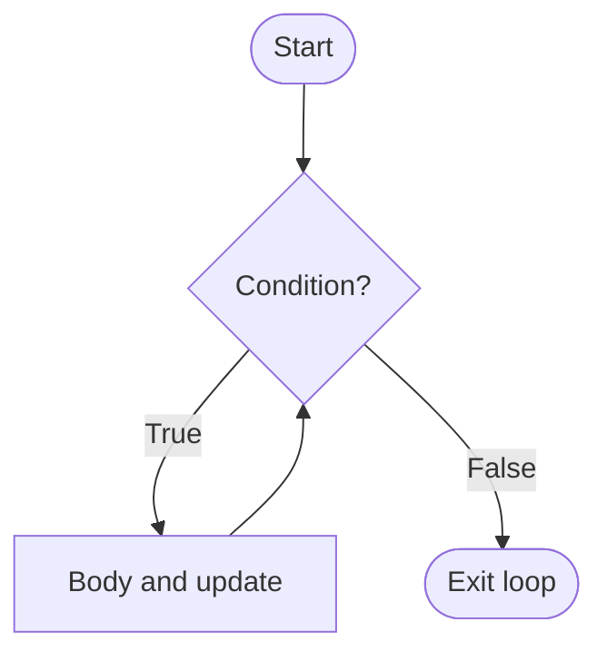
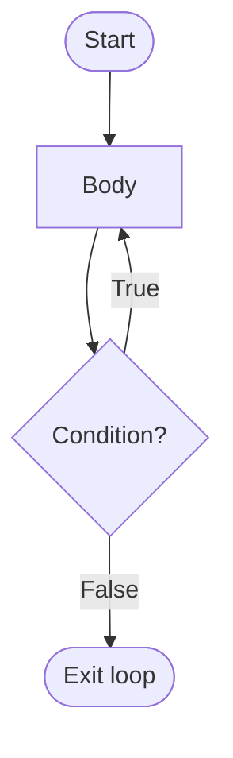

# Topic 2: Looping Statements

**Unit III | HCAC-104 Programming in C**

## 1. Introduction

A **loop** repeats a block of statements while a condition holds. Every loop has four parts: **initialization**, **condition**, **body** and **update**. C provides three loops: `while`, `do-while` and `for`.

## 2. The `while` Loop

```c
while (condition) {
    body;
}
```

The condition is tested **before** each pass (entry-controlled). If it is false at the start, the body never runs.

```c
int i = 1;
while (i <= 5) {
    printf("%d ", i);
    i++;
}
/* Output: 1 2 3 4 5 */
```



Tested: [Program 15: Reverse a Number](../../Programs/Program-15-Reverse-a-Number-using-while/README.md).

## 3. The `do-while` Loop

```c
do {
    body;
} while (condition);
```

The condition is tested **after** the body (exit-controlled), so the body runs **at least once**. Note the semicolon after `while (...)`.



Tested: [Program 16: Menu-Driven Program](../../Programs/Program-16-Menu-Driven-Program-do-while/README.md).

## 4. The `for` Loop

```c
for (initialization; condition; update) {
    body;
}
```

Execution order: initialization (once) -> condition -> body -> update -> condition -> ... until the condition is false.

```c
for (int i = 1; i <= 5; i++)
    printf("%d ", i);
/* Output: 1 2 3 4 5 */
```

Declaring `int i` inside the `for` header is allowed from C99 onward.

All three parts are optional. `for (;;)` is an infinite loop.

Tested: [Program 14: Factorial](../../Programs/Program-14-Factorial-using-for-Loop/README.md) and [Program 17: Fibonacci](../../Programs/Program-17-Fibonacci-Series/README.md).

## 5. Nested Loops

A loop inside another loop. The inner loop completes all its passes for every pass of the outer loop.

```c
for (i = 1; i <= 3; i++) {
    for (j = 1; j <= i; j++)
        printf("* ");
    printf("\n");
}
```

Output:

```text
* 
* * 
* * * 
```

Tested: [Program 19: Star Triangle](../../Programs/Program-19-Star-Triangle-Pattern/README.md).

## 6. Comparison of the Loops

| Basis | `while` | `do-while` | `for` |
|---|---|---|---|
| Condition checked | Before the body | After the body | Before the body |
| Minimum executions | 0 | 1 | 0 |
| Type | Entry-controlled | Exit-controlled | Entry-controlled |
| Best used when | Number of repetitions is unknown | Body must run at least once (menus, validation) | Number of repetitions is known |
| Semicolon after condition | No | Yes | No |

## 7. Infinite Loops and Common Mistakes

| Mistake | Effect |
|---|---|
| Forgetting the update (`i++`) | Loop never ends |
| `while (i = 1)` instead of `==` | Always true |
| Semicolon after `for (...)` or `while (...)` | Empty body; the real body runs once afterward |
| Off-by-one (`<` vs `<=`) | One pass too many or too few |

Infinite loops are sometimes deliberate (`while (1)` with a `break` inside).

## 8. Exam-Oriented Answers

### 5-mark: Differentiate between `while` and `do-while`.
Use the table above and give the "menu" example for `do-while`.

### 5-mark: Explain the `for` loop with syntax, flowchart and an example.
Syntax, the order of execution, the output of printing 1 to 5, and the note that all parts are optional.

### 10-mark: Explain the looping statements of C with examples.
Define a loop and its four parts; describe `while`, `do-while`, `for` with syntax, flowcharts and examples; explain nested loops with the triangle program; give the comparison table; end with a summary. Attach tested Program 14 or 19 with output.

## 9. Summary

`while` and `for` test the condition first; `do-while` tests it last and always runs once. Use `for` when the count is known, `while` when it is not, and nested loops for tables and patterns. Make sure every loop updates its variable so it can end.

---

[Previous: Selection Statements](Topic-01-Selection-Statements.md) | [Next: Jump Statements](Topic-03-Jump-Statements.md)
