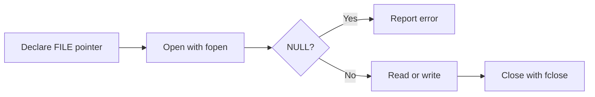

# Topic 1: File Handling Concepts and Access Methods

**Unit VII | HCAC-104 Programming in C**

## 1. Introduction

### 1.1 Why Files?
Variables live in RAM and vanish when the program ends. A **file** is a named collection of data on secondary storage (disk) that **persists** after the program stops. Files also allow large data, sharing between programs, and input from outside the keyboard.

### 1.2 Definition
**File handling** means creating, opening, reading, writing and closing files from a program.

## 2. Streams and the `FILE` Pointer

C treats input and output as **streams** of bytes. Three streams are opened automatically:

| Stream | Meaning | Default device |
|---|---|---|
| `stdin` | Standard input | Keyboard |
| `stdout` | Standard output | Screen |
| `stderr` | Standard error | Screen |

For your own files you use a pointer of type `FILE *` (the type is defined in `<stdio.h>`):

```c
FILE *fp;
fp = fopen("data.txt", "r");
```

## 3. Types of Files

| Basis | Text file | Binary file |
|---|---|---|
| Content | Human-readable characters | Raw bytes, same as in memory |
| Line ends | Translated on some systems (such as Windows) | No translation |
| Reading tools | Any text editor | Only the program that wrote it |
| Size for numbers | Larger (digits as characters) | Compact |
| Typical functions | `fprintf`, `fscanf`, `fgets`, `fputs`, `fgetc`, `fputc` | `fread`, `fwrite` |
| Mode letter | `r`, `w`, `a` | `rb`, `wb`, `ab` |

## 4. Access Methods

| Method | Description | Functions |
|---|---|---|
| **Sequential access** | Read or write from the beginning to the end, in order | `fgetc`, `fgets`, `fscanf`, `fprintf` |
| **Random (direct) access** | Jump straight to any position in the file | `fseek`, `ftell`, `rewind` |

Sequential access suits text files and logs. Random access suits fixed-size records, such as the 50th student record, without reading the first 49. See [Topic 4](Topic-04-Random-Access-and-Error-Handling.md).

## 5. Steps of File Processing



1. Declare a `FILE *` pointer.
2. Open the file with `fopen` and **check for `NULL`**.
3. Read from or write to it.
4. Close it with `fclose`.

## 6. Exam-Oriented Answers

### 5-mark: Differentiate between text files and binary files.
Use the table in section 3 and add one example function for each.

### 5-mark: Explain sequential and random access.
Definitions, the two function sets and one use case each.

### 5-mark: Why are files needed? Explain the steps of file handling.
Persistence and large data; the four steps with the `FILE *` pointer and the flowchart.

## 7. Summary

Files store data permanently. A `FILE *` pointer represents an open file. Text files are readable; binary files hold raw bytes. Data is accessed sequentially or randomly.

---

[Back to Unit Introduction](Introduction.md) | [Next: File Functions and Modes](Topic-02-File-Functions-and-Modes.md)
